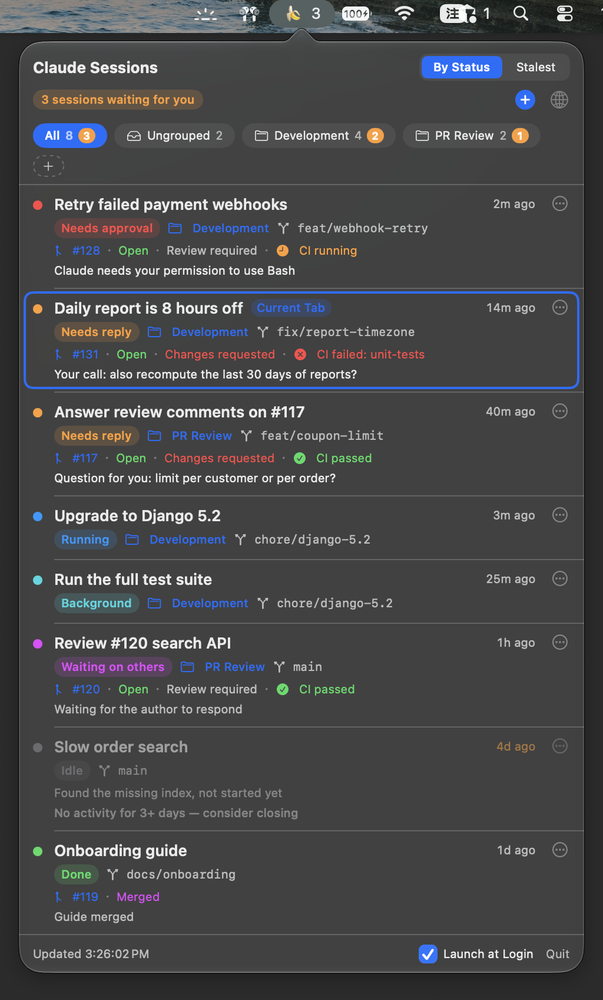

# Claude Session Bar

English | [繁體中文](README.md)

A menu bar dashboard for Claude Code sessions on macOS: it lists every open session, tells you what each one is waiting on, and jumps to the matching iTerm2 tab with one click.

> This is an unofficial personal project. It is not affiliated with or endorsed by Anthropic.

<p align="center"></p>

## Requirements

- macOS 14 or later, with the Xcode Command Line Tools (Swift 5.9+)
- [iTerm2](https://iterm2.com/) — sessions must run in iTerm2 for click-to-jump and opening new tabs
- The [Claude Code](https://docs.claude.com/en/docs/claude-code) CLI (`claude`), logged in
- Optional: [GitHub CLI](https://cli.github.com/) (`gh`) for PR / CI status, [Cursor](https://cursor.com/) for opening branches

## Install

1. Make sure the Xcode Command Line Tools are installed (`swift --version` prints a version if they are; otherwise run):

   ```bash
   xcode-select --install
   ```

2. Clone, build and install:

   ```bash
   git clone https://github.com/kenhaowang/ClaudeSessionBar.git
   cd ClaudeSessionBar
   ./build.sh install                   # build, copy to ~/Applications/ClaudeSessionBar.app and launch
   ```

   The app is built and signed on your own Mac, so Gatekeeper does not block it.

3. Install the Claude Code hooks (they tell the app which session is waiting for a permission and which just finished):

   ```bash
   python3 install_hooks.py    # writes ~/.claude/settings.json, backing up any existing file first
   ```

   Claude Code reads hooks when a session starts, so sessions that are already open need a restart to pick them up.

4. Click the menu bar icon:
   - The first time you click a session, macOS asks whether the app may control iTerm2 — click "Allow"
   - Turn on "Launch at Login" at the bottom if you like
   - Click ＋ → "Working directory: … (Change…)" at the bottom to set where new sessions start

## Update

```bash
cd ClaudeSessionBar
git pull
./build.sh install                       # quits the running copy and launches the new one
python3 install_hooks.py        # only needed when the hooks changed; safe to re-run
```

## Uninstall

```bash
/usr/bin/python3 install_hooks.py --uninstall
rm -rf ~/Applications/ClaudeSessionBar.app ~/.claude/session-dashboard
```

## Where the data comes from

| Information | Source |
|---|---|
| Session list, running / idle | `claude agents --json` |
| Title, branch, when you last spoke | `~/.claude/projects/**/<sessionId>.jsonl` |
| Waiting for permission, background work | hooks write to `~/.claude/session-dashboard/state/` |
| What it is waiting on, suggested name | `claude -p --model haiku` after each turn (uses your own Claude login and counts toward your usage), cached in `summaries/` |
| Custom names, manual states | `names.json`, `overrides.json` |

A manually set state goes back to automatic the next time you send that session a message.

## New session

＋ in the header opens a menu; each choice opens a new tab in iTerm2's current window and runs `claude` in the working directory:

- "Just Open a New Tab": the session isn't put in any group
- "Put the new session in:" lists your groups; pick one and the new session lands there
- "New Folder…": name a new group, which is created with the new session in it
- "Working directory: <folder> (Change…)": change where new sessions start (your home directory by default; right-click ＋ → "Choose Folder…" works too)

New sessions start with `claude --session-id <pre-generated id>`, so they show up in the chosen group right away.

## Restoring sessions after a restart

The app records open sessions in `open-sessions.json`. Before macOS logs out, restarts or shuts down (including forced updates) it freezes that record; on the next launch it compares, and any session that did not come back is listed in a banner at the top. You can reopen them all, or one by one, with `cd <original dir> && claude --resume <id>` (`--resume` keeps the id, so groups and names carry over). Without a restart, a banner also appears when 3 or more sessions disappear at once (e.g. iTerm2 crashed).

## PR and CI status

A session's PR is the last PR link in its conversation that belongs to the same repo (by git origin). Status, reviews and CI (both check runs and commit statuses) come from `gh pr view`. Open PRs refresh every 2 minutes (every minute while CI runs), merged / closed ones every 30 minutes. Click `#number` to open the PR in the browser.

## Open a branch in Cursor

A session's "⋯" menu has "Open <branch> in Cursor": if the branch is already checked out in a worktree (including the main checkout) Cursor opens it directly; otherwise the row asks whether to create `.claude/worktrees/<branch, with / replaced by ->` and only runs `git worktree add` after you confirm.

Note: the branch is whatever was checked out when the session's last message was written; when several sessions share one checkout, another session may have switched it.

## Groups

- The row of tabs under the title is All / Ungrouped / your groups; click a tab to show only that group, tabs wrap when they don't fit
- The number on a tab is its session count; the small orange badge is how many are waiting on you
- ＋ creates a group; or pick "Move to Group → New Group…" in a session's "⋯" menu to create one and file the session at once
- Drag a session onto a group tab to move it there; drag it onto "Ungrouped" to take it out
- Tabs can be reordered by dragging, "All" and "Ungrouped" included; a blue "|" marks the drop point — the left half of a tab inserts before it, the right half after it, and dropping on ＋ moves it to the end
- Right-click a group tab (or use the "⋯" next to the selected one) to rename it, move it left / right, or delete it (its sessions go back to Ungrouped)
- In "All", each session shows the group it belongs to
- Groups, tab order and the selected tab are stored in `groups.json`, keyed by sessionId

## Debugging

```bash
.build/release/ClaudeSessionBar --dump               # print the current state (including groups)
.build/release/ClaudeSessionBar --dump --summarize   # run the Haiku summaries first, then print
.build/release/ClaudeSessionBar --snapshot out.png   # render the popover offscreen to an image (add --dark for dark mode)

# Launch the real menu bar app, open its popover, take screenshots, then quit
build/ClaudeSessionBar.app/Contents/MacOS/ClaudeSessionBar --selftest /tmp/csb-selftest

# Show where "Open in Cursor" would go for each session (read-only)
.build/release/ClaudeSessionBar --worktree-plan

# Print each session's PR status (calls gh)
.build/release/ClaudeSessionBar --dump --prs

# Check the restart-restore logic (point it at an empty temp folder)
mkdir -p /tmp/csb-restore && CSB_DASHBOARD_DIR=/tmp/csb-restore .build/release/ClaudeSessionBar --check-restore

# Check PR link parsing and CI evaluation
.build/release/ClaudeSessionBar --check-pr

# Check worktree creation (runs in a throwaway test repo, deleted afterwards)
.build/release/ClaudeSessionBar --check-worktree

# Regenerate the README screenshot with made-up sessions (a real screen capture; the terminal needs
# Screen Recording permission, otherwise the app draws its own windows instead)
CSB_DEMO=1 CSB_LANG=en CSB_DASHBOARD_DIR=/tmp/csb-demo \
  build/ClaudeSessionBar.app/Contents/MacOS/ClaudeSessionBar --screenshot docs/screenshot-en.png

# Check group operations; always point it at a copy, or it edits your real groups.json
cp -R ~/.claude/session-dashboard /tmp/csb-copy && rm -f /tmp/csb-copy/groups.json
CSB_DASHBOARD_DIR=/tmp/csb-copy .build/release/ClaudeSessionBar --check-groups
```

## Version

Current version: **v1.1.1** ([all releases](https://github.com/kenhaowang/ClaudeSessionBar/releases))

### v1.1.1 (2026-10-27)

- Fix the build with only the Command Line Tools and the macOS 27 SDK
- Fix `build.sh` not finding the binary with newer SwiftPM (the swiftbuild backend, default from Swift 6.4)
- Screenshots in the README

### v1.1 (2026-10-27)

- ＋ is now a menu: open a plain new tab, pick the group the new session goes into, or create a new folder for it on the spot
- The working directory is shown at the bottom of the ＋ menu and can be changed from there

### v1.0.0 (2026-10-22)

First public release.

- The menu bar icon changes with how many sessions are waiting on you
- Lists every open Claude Code session with its state (needs approval, needs reply, running, background, idle, done, …); click one to jump to its iTerm2 tab
- After each turn, Haiku works out what the session is waiting on and suggests a name
- Custom session names and manual states (back to automatic after your next message)
- Groups: create, rename, delete, reorder by dragging, drag sessions into a group
- ＋ opens a new iTerm2 tab running `claude`; the folder is set from its right-click menu
- After a restart or an iTerm2 crash, lists the sessions that didn't come back and reopens them with `claude --resume`
- Shows the PR status, reviews and CI for each session's PR (needs `gh`)
- Opens a session's branch in Cursor, creating a git worktree when needed
- Chinese / English UI, launch at login

## License

[MIT](LICENSE)
